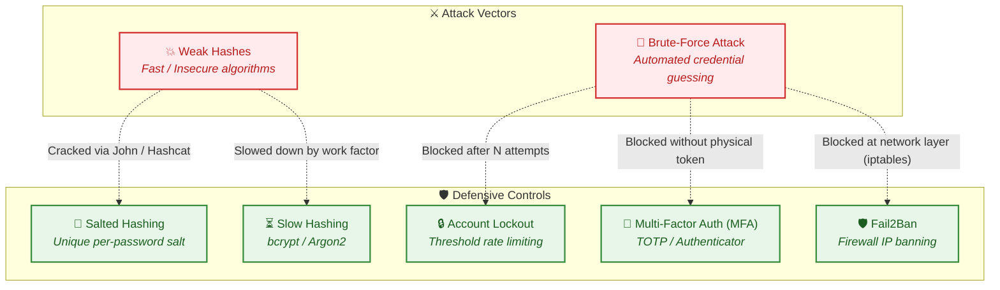

# 🛡️ AuthShield: Authentication & Password Security

> **Quick Reference Guide & Security Blueprint**  
> *Core concepts covering password attack vectors, modern cryptographic hashing, and layered defense mechanisms.*

---

## 📊 Security Architecture Overview



---

## ⚔️ Threat & Attack Concepts

### 1. ⚠️ Weak Hashes
> **Definition:** Passwords that are stored using insecure or fast hashing methods, making it easier for attackers to guess the original password using tools like **John the Ripper** or **Hashcat**.

* **Why it is vulnerable:** Algorithms like MD5, SHA-1, or unsalted SHA-256 compute billions of hashes per second on modern GPUs. Attackers can quickly run dictionary attacks or precomputed lookups.
* **Exploitation Tools:** `John the Ripper`, `Hashcat`.
* **Impact:** Complete exposure of plaintext credentials in the event of a database leak.

> [!WARNING]
> Fast cryptographic hashes are intended for message integrity, **not** password storage. Storing raw or single-iteration hashes leaves credentials vulnerable to near-instant cracking.

---

### 2. 🔨 Brute-Force Attack
> **Definition:** An attack where someone repeatedly tries different password combinations on a login page until they find the correct password. Tools like **Hydra** automate this process.

* **Execution:** Attackers test wordlists, common passwords, or systematic permutations against authentication interfaces.
* **Exploitation Tools:** `THC-Hydra`, `Burp Suite Intruder`, custom credential stuffing scripts.
* **Impact:** Unauthorized account takeover when weak, default, or reused passwords exist.

> [!CAUTION]
> Online brute-force attacks continuously stress server resources and can compromise user accounts unless active throttling or lockout controls are enforced.

---

## 🛡️ Defensive Controls & Mitigation

### 3. 🧂 Salted Hashing
> **Definition:** Adds a random value (called a **salt**) to a password before hashing it. This makes identical passwords produce different hashes and makes precomputed attacks harder.

* **Key Mechanics:**
  $$\text{Stored Record} = \{\text{salt}, \text{Hash}(\text{password} + \text{salt})\}$$
* **Defeats:** Rainbow tables and precomputed hash tables.
* **Benefit:** Two users with the password `P@ssword123` will store completely distinct hashes, preventing bulk cracking.

> [!TIP]
> Always generate a cryptographically strong, unique pseudo-random salt for every single password entry. Salts do not need to be secret, but must never be reused.

---

### 4. ⏳ Slow Hashing
> **Definition:** Uses algorithms like **bcrypt** or **Argon2** that intentionally take more time and memory to calculate each password hash, making password cracking much harder.

* **Standard Algorithms:** `Argon2id` (winner of the Password Hashing Competition), `bcrypt`, `PBKDF2`, `scrypt`.
* **Configurable Work Factor:** Allows administrators to tune iteration counts or memory parameters as hardware improves over time.
* **Real-World Impact:**
  * Fast Hash (MD5/SHA1): **Billions** of attempts/second.
  * Slow Hash (bcrypt / Argon2): **Tens or hundreds** of attempts/second per GPU.

> [!IMPORTANT]
> Tune your slow-hashing work factor to consume ~100–500ms on server authentication. This creates zero perceptible delay for legitimate users while making offline brute-force cracking practically impossible.

---

### 5. 🔒 Account Lockout
> **Definition:** Temporarily blocks an account after several failed login attempts to prevent attackers from continuously guessing passwords.

* **Implementation Strategies:**
  * **Progressive Delay:** Incremental sleep delays between failed attempts (e.g., 1s, 2s, 4s, 8s).
  * **Threshold Lockout:** Temporary lockout after $N$ failed attempts (e.g., 5 attempts locks out for 15 minutes).
  * **Network Throttling:** Blocking abusive source IPs using tools such as `fail2ban`.
* **Protection Focus:** Neutralizes automated online brute-force tools (like Hydra).

> [!NOTE]
> Consider combining username lockouts with IP rate-limiting and CAPTCHA to mitigate Denial-of-Service (DoS) risks where an attacker maliciously locks out legitimate users.

---

### 6. 📱 MFA (Multi-Factor Authentication)
> **Definition:** Requires an additional verification method besides the password, such as a code from **Google Authenticator**, to log in.

* **Core Principles:**
  * **Something you know:** Master Password / Passphrase
  * **Something you have:** Authenticator App (TOTP - RFC 6238), Security Key (FIDO2 / WebAuthn)
  * **Something you are:** Biometrics (Fingerprint / Face ID)
* **Threat Mitigation:** Even if an attacker cracks a password hash or guesses credentials via brute force, access is blocked without the secondary verification factor.

> [!TIP]
> Time-based One-Time Password (TOTP) implementations like Google Authenticator or Microsoft Authenticator provide strong, cost-effective MFA with no reliance on vulnerable SMS networks.

---

### 7. 🛡️ Fail2Ban (Intrusion Prevention & Network Shield)
> **Definition:** An automated intrusion prevention system that scans log files in real time for suspicious patterns (such as repeated failed logins) and dynamically updates Linux firewall rules (`iptables` / `nftables`) to block the offending IP address.

* **Core Operational Pipeline:**
  $$\text{Failed Attempt} \xrightarrow{\text{written to}} \texttt{auth.log} \xrightarrow{\text{matched by}} \text{failregex} \xrightarrow{\ge \text{maxretry}} \text{iptables DROP rule}$$

* **Key Mechanics & Configuration:**
  * **Filter (`filter.d/flaskapp.conf`):** Defines the regular expression matching failed authentication events:
    ```ini
    failregex = Failed login attempt for user=\S+ from <HOST>
    ```
  * **Jail (`jail.d/flaskapp.local`):** Defines detection thresholds and ban actions:
    * `findtime`: The time window monitored for repeated failures (e.g., `600` seconds / 10 minutes).
    * `maxretry`: The number of failed attempts allowed within `findtime` before banning (e.g., `5` attempts).
    * `bantime`: The duration an abusive IP is completely blocked (e.g., `900` seconds / 15 minutes).
  * **Action:** Automatically adds packet-filtering rules to `iptables` to drop all incoming TCP packets destined for the target port (e.g., `5000`) from the banned IP.

* **App-Level Lockout vs. Fail2Ban — Why Both Are Essential:**
  * **App-Level Lockout (Account Shield):** Tracks failed attempts per username in the database. Protects an account even if an attacker attacks from multiple rotating IP addresses (distributed brute-force). However, every request still forces Flask and Python to execute code and query the database.
  * **Fail2Ban (Server & Network Shield):** Tracks the *source IP address*. Once triggered, the Linux kernel firewall drops incoming traffic instantly. The request never touches Python, saving server CPU, RAM, and bandwidth, which prevents Denial-of-Service (DoS) and application crashes.
  * **Layered Synergy:** App lockout safeguards user accounts against distributed credential attacks; Fail2Ban safeguards the server infrastructure from being overwhelmed by brute-force automation tools like Hydra.

> [!IMPORTANT]
> **Online vs. Offline Attack Scope:**  
> Fail2Ban only protects active **online** network endpoints (such as stopping Hydra from brute-forcing `/login`). If an attacker extracts the database (`users.db`), Fail2Ban is completely bypassed because **offline** attacks (John the Ripper / Hashcat) run locally on the attacker's hardware without sending any network packets. Only slow, salted hashing (Argon2 / bcrypt) protects stolen offline hashes.

---

## 📋 Summary Matrix

| Concept | Classification | Primary Mechanism | Key Tools / Standards | Primary Countermeasure Against |
| :--- | :---: | :--- | :--- | :--- |
| **Weak Hashes** | 🔴 Threat | Outdated/fast hash algorithms without computational cost | John the Ripper, Hashcat | Upgrading to Argon2 / bcrypt |
| **Brute-Force Attack** | 🔴 Threat | Rapid, automated password guessing against login endpoints | Hydra, Burp Suite | Account lockout, rate limits & MFA |
| **Salted Hashing** | 🟢 Defense | Unique random seed prepended/appended to password | Cryptographic PRNG | Rainbow tables & cross-user cracking |
| **Slow Hashing** | 🟢 Defense | Adjustable memory & CPU work factors | Argon2id, bcrypt, PBKDF2 | Offline hardware-accelerated cracking |
| **Account Lockout** | 🟢 Defense | Threshold-based temporary suspension & request limiting | Database state, redis rate-limiter | Online automated guessing (Hydra) |
| **MFA** | 🟢 Defense | Multi-layered independent authentication factors | TOTP (RFC 6238), WebAuthn | Credential leakage & password reuse |
| **Fail2Ban** | 🟢 Defense | Log monitoring + automated kernel firewall IP banning | fail2ban, iptables, nftables | Network brute-force (Hydra) & server DoS |

---

## 🚀 Defense-in-Depth Best Practices Checklist

- [x] **Store passwords using Argon2id or bcrypt** with calibrated cost factors.
- [x] **Enforce unique per-user cryptographic salts** automatically handled by the hashing library.
- [x] **Deploy online rate limiting & fail2ban rules** to thwart automated login attacks.
- [x] **Integrate TOTP Multi-Factor Authentication (MFA)** for all sensitive user accounts.
- [x] **Implement secure password policies** focusing on length and entropy rather than complex arbitrary rotations.

