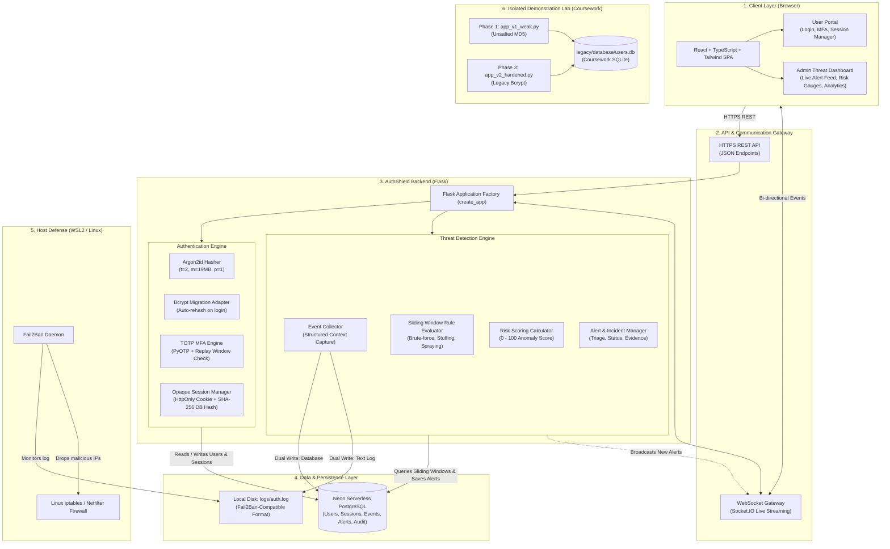
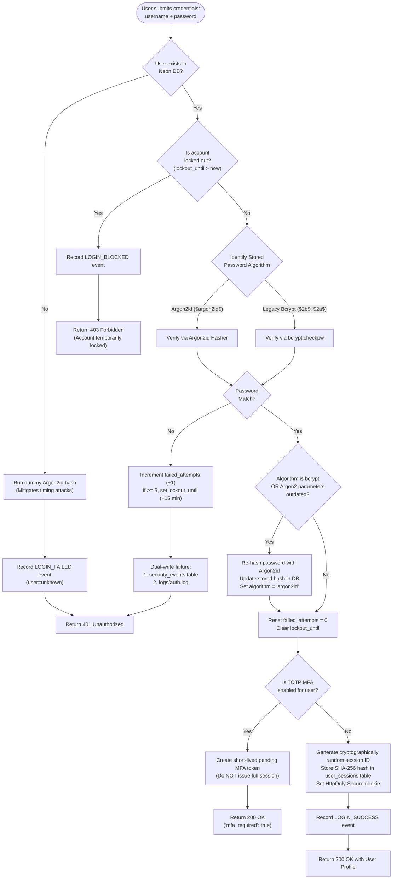
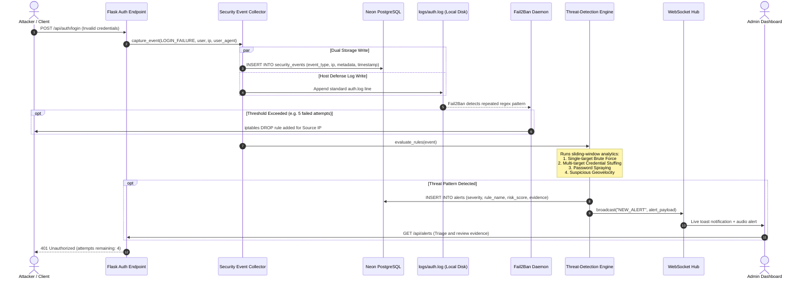
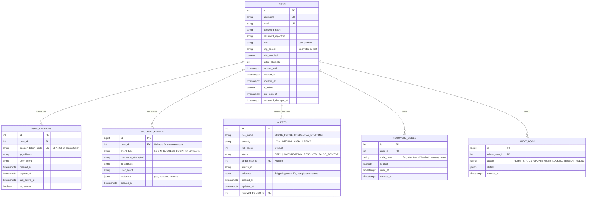
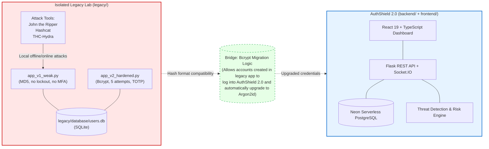

# AuthShield 2.0 — Architecture & System Design

**Project:** AuthShield 2.0 (Security Event Detection & Threat-Monitoring Platform)  
**Origin:** P11 Authentication & Password Security Coursework  
**Stack:** React + TypeScript + Tailwind CSS | Python + Flask | PostgreSQL (Neon Cloud) | Fail2Ban  

---

## 1. Executive Summary

AuthShield 2.0 evolves a standalone academic password-security lab (P11) into a full-featured, production-ready **authentication security and active threat-monitoring platform**.

Traditional authentication systems only answer binary questions: *"Did the login succeed or fail?"*  
**AuthShield 2.0 answers:**
* *Who* is attempting authentication, from *where*, and with *what patterns*?
* Is this an isolated typographical error, or an automated credential stuffing attack?
* What is the calculated risk score based on historical and cross-account behavior?
* What defensive action should be taken (rate-limiting, session revocation, automated firewall IP bans)?

---

## 2. High-Level System Architecture

The system is organized into decoupled layers: a client user interface, a Python Flask REST/WebSocket application, persistent serverless PostgreSQL storage on Neon Cloud, local host-level defense daemons, and an isolated legacy lab.

---

## 3. Subsystem Breakdown & Component Responsibilities

| Subsystem | Primary Responsibilities | Technologies |
| :--- | :--- | :--- |
| **Frontend UI** | Renders login flows, TOTP setup QR codes, session management, real-time alert streams, and analytics charts. Never makes security or authorization decisions. | React 19, TypeScript, Vite, Tailwind CSS, Recharts, Lucide Icons |
| **Flask API Backend** | Handles request validation, password hashing, session lifecycle, error formatting, RBAC checks, and rate-limiting. | Python 3, Flask, Flask-SQLAlchemy, Flask-CORS, Flask-Limiter |
| **Authentication Module** | Enforces password complexity, hashes with Argon2id, verifies and migrates legacy bcrypt hashes, validates TOTP tokens with replay prevention. | `argon2-cffi`, `bcrypt`, `pyotp`, `qrcode`, `cryptography` |
| **Security Event Collector** | Intercepts all authentication actions and extracts structured metadata (IP address, User-Agent, endpoint, outcome, user ID). Performs dual-write to Neon DB and `logs/auth.log`. | Python, SQLAlchemy, Standard Library Logging |
| **Threat-Detection Engine** | Runs sliding-window detection rules across ingested events to flag brute-force attacks, multi-account stuffing, password spraying, and compromised sessions. | In-memory evaluation + PostgreSQL aggregation queries |
| **Risk & Alert Manager** | Calculates risk scores (0–100), assigns severity tiers (`LOW`, `MEDIUM`, `HIGH`, `CRITICAL`), packages evidence payloads, and manages alert triage states (`OPEN`, `INVESTIGATING`, `RESOLVED`, `FALSE_POSITIVE`). | PostgreSQL JSONB / Alembic migrations |
| **Persistence (Cloud)** | Serverless, autoscaling PostgreSQL hosting relational tables with connection pooling. | Neon Serverless PostgreSQL, SQLAlchemy ORM, psycopg3 |
| **Network Defense** | Scans `logs/auth.log` for repeated failed authentication attempts from external attackers (e.g. THC-Hydra) and blocks their IP via Linux iptables. | Fail2Ban, iptables (WSL2/Linux) |
| **Legacy Lab** | Preserves original academic coursework demonstrations (MD5 cracking with John the Ripper and Hashcat) isolated inside `legacy/`. | Python Flask, SQLite 3 |

---

## 4. Authentication & Migration Workflow

The authentication flow enforces strong cryptography while transparently upgrading legacy accounts without forcing an immediate password reset.

---

## 5. Security Event Collection & Threat-Detection Pipeline

AuthShield does not treat logs as passive text dumps; it treats security events as structured data streams feeding an active detection engine.

---

## 6. Database Entity-Relationship (ER) Model

The Neon PostgreSQL schema separates account identity, cryptographic secrets, authentication state, and threat audit trails.

---

## 7. Defense-in-Depth Layered Model

AuthShield 2.0 employs layered controls so that a failure or vulnerability at any single point is stopped by the surrounding defensive layers.

```mermaid
flowchart TD
    subgraph L1["Layer 1: Network & Firewall Layer"]
        L1_Desc["• Fail2Ban monitoring logs/auth.log\n• iptables IP blocking for automated brute-force attacks\n• Rate-limiting at the transport layer"]
    end

    subgraph L2["Layer 2: Transport & Edge HTTP Layer"]
        L2_Desc["• TLS 1.3 / HTTPS encryption in transit\n• Strict CORS origin whitelisting\n• Flask-Limiter endpoint rate limits\n• Flask-WTF CSRF protection on state-changing requests"]
    end

    subgraph L3["Layer 3: Application & Session Layer"]
        L3_Desc["• Role-Based Access Control (RBAC: user vs admin)\n• Opaque session IDs stored as SHA-256 hashes\n• HttpOnly, SameSite=Lax, Secure session cookies\n• Granular session listing and remote revocation\n• Automatic session termination on password reset"]
    end

    subgraph L4["Layer 4: Authentication & Cryptographic Layer"]
        L4_Desc["• Memory-hard Argon2id hashing (OWASP standard)\n• Automatic transparent migration from legacy bcrypt\n• TOTP Multi-Factor Authentication with anti-replay tracking\n• AES/Fernet encryption for TOTP secrets at rest\n• One-time hashed recovery codes"]
    end

    subgraph L5["Layer 5: Detection & Anomaly Monitoring Layer"]
        L5_Desc["• Structured event capture across all auth endpoints\n• Sliding-window rule detection engine\n• 0-100 risk scoring algorithm\n• Security alerts with evidence capture and incident triage\n• Real-time WebSocket streaming to Admin Dashboard"]
    end

    subgraph L6["Layer 6: Persistence & Cloud Data Layer"]
        L6_Desc["• Cloud-hosted serverless PostgreSQL on Neon\n• Connection pooling to prevent socket exhaustion\n• Database SSL mode required (sslmode=require)\n• Branching for isolated automated test runs"]
    end

    L1 --> L2
    L2 --> L3
    L3 --> L4
    L4 --> L5
    L5 --> L6
```

---

## 8. Legacy Coursework vs AuthShield 2.0 Isolation Boundary

To preserve the historical P11 coursework without compromising the new architecture, the codebase enforces an isolation boundary:

---

## 9. Summary of Key Architectural Advantages

1. **Separation of Concerns:** React handles visual presentation and alert interaction; the Flask backend enforces all authentication, detection, and authorization logic.
2. **Resilience to Offline Attacks:** Storing credentials with memory-hard **Argon2id** (`m=19MB`, `t=2`) protects stolen databases against GPU-accelerated cracking clusters (Hashcat/John).
3. **Continuous Detection:** The platform detects attacks *as they happen* rather than post-mortem, alerting administrators to credential stuffing and password spraying within seconds.
4. **Zero-Downtime Migration:** Users from the earlier bcrypt coursework can log in immediately; their credentials are automatically re-hashed with Argon2id on their first successful authentication.
5. **Full Coursework Preservation:** All original Phase 1 (MD5) and Phase 2/3 (Bcrypt) attack demonstrations remain intact in `legacy/` for evaluation and academic review.
